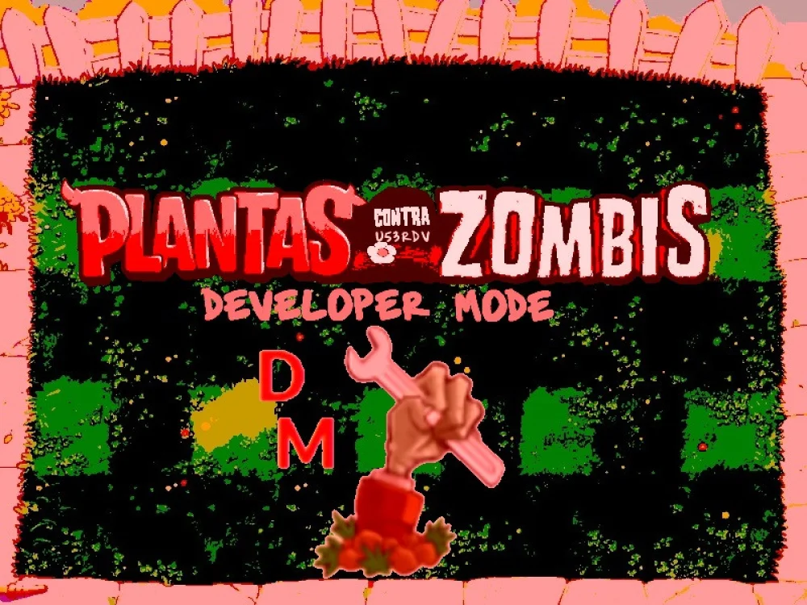
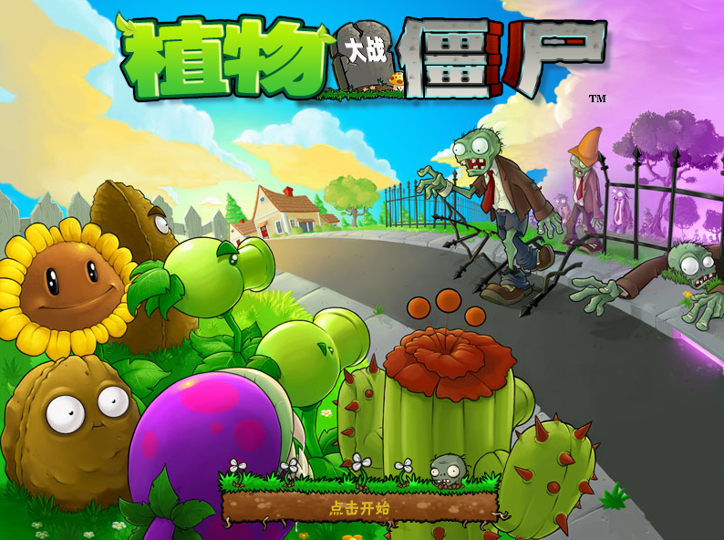
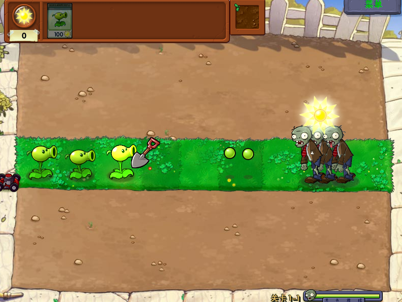

# PvZ _U53RDV v1.1

**PvZ _U53RDV** é uma versão modificada de **Plants vs. Zombies** que transforma o início da aventura. Em vez de começar imediatamente com a progressão tradicional, o mod apresenta uma fase inicial preparada especialmente para introduzir sua própria experiência.

O jogo começa com três Peashooters já posicionados no gramado. Eles não são apenas defesas iniciais: fazem parte do gatilho de abertura do mod. Ao usar a pá para removê-los, o jogador libera o começo da jornada e pode seguir para o conteúdo do U53RDV.

Mod por **AAA土豆专卖**.

## Sobre o mod

- **Introdução própria:** a primeira fase funciona como uma pequena abertura interativa, diferente do início comum de Plants vs. Zombies.
- **Gatilho de progresso:** remover as três Peashooters é a ação necessária para iniciar o mod.
- **Experiência baseada em PvZ:** a jogabilidade parte da fórmula clássica de plantar defesas, coletar sóis e impedir os zumbis de atravessarem o gramado.

## Download

Baixe a versão mais recente pela página de [Releases](https://github.com/ViselBrx/Pvz-U53RDV_1.1/releases). Lá está disponível o arquivo `.rar` contendo a **pasta limpa do jogo**, pronta para extrair e jogar.

## Como iniciar o mod

Ao entrar na fase inicial, haverá três **Peashooters** no gramado. Use a pá para removê-los:

1. Selecione a pá.
2. Remova as três Peashooters.
3. Depois que o terceiro for removido, o mod começará.

## Screenshots

  
  

## Como jogar

1. Baixe e extraia o arquivo `.rar` dos Releases.
2. Abra a pasta extraída.
3. Execute o jogo e siga a instrução acima para iniciar o mod.
